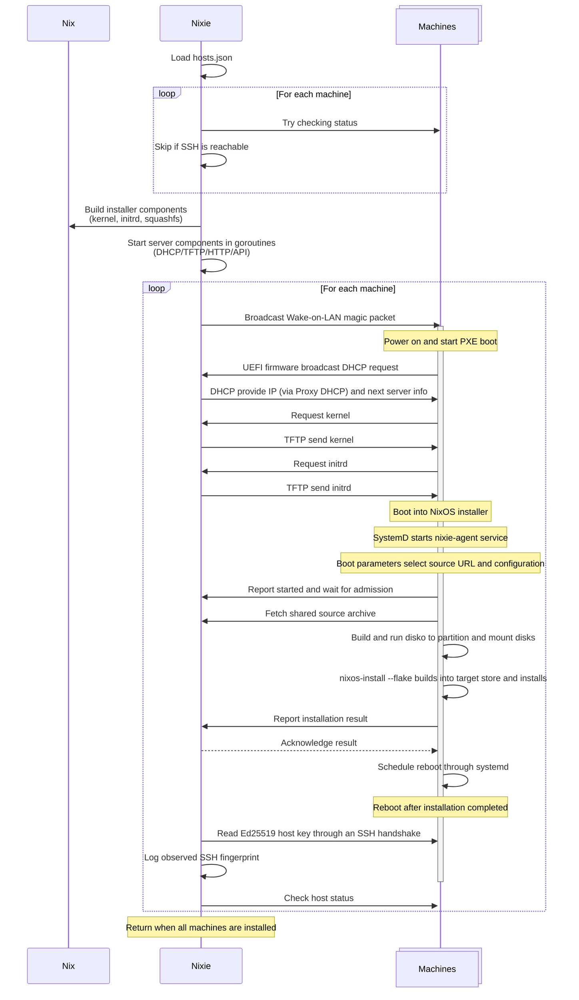

# Nixie - bare metal provisioning engine for NixOS


> [!WARNING]
> Basic [features](#features) are functional and you can try them out, but some
> parts are still missing and there are known issues.

Nixie enables zero-touch deployment of NixOS to multiple machines over the
network, turning blank hard drives into fully configured systems in minutes.

Nixie is a simpler, stateless alternative to [Foreman](https://theforeman.org),
[MAAS](https://canonical.com/maas), [OpenStack
Ironic](https://docs.openstack.org/ironic),
[Tinkerbell](https://tinkerbell.org), etc., focusing on NixOS deployments on
bare metal (though it can also be used in virtualized environments).

## Features

Currently, only `x86_64-linux` is supported.

- [x] Simple, declarative JSON host inventory
- [x] Build a custom NixOS installer from a flake
- [x] Built-in PXE server based on [Pixiecore](https://github.com/danderson/netboot/tree/main/pixiecore) to serve netboot components from the custom installer
- [x] Install NixOS from a flake using Nix, disko, and nixos-install
- [x] Remote power-on with [Wake-on-LAN](https://en.wikipedia.org/wiki/Wake-on-LAN)
- [x] Read-only host inventory with fixed IP addresses
- [x] Ephemeral PXE server [^1]
- [x] Concurrent installation across hosts
- [ ] Support IPv6 single-stack

[^1]: No pre-configured PXE server is required to install other machines - you
    only need to run Nixie on your laptop or workstation. This solves the
    "first machine in the data center" problem: in bare-metal setups with
    persistent PXE servers, you would otherwise need to automate the installation
    of the PXE server itself.

## Usage

Example command to boot a custom NixOS installer and install the corresponding
NixOS configuration from [`./examples/flake.nix`](./examples/flake.nix) on
multiple bare-metal machines based on the MAC addresses defined in
[`./examples/hosts.json`](./examples/hosts.json).

```sh
# Running as root for privileged ports
sudo nixie \
    --installer ./examples#nixosConfigurations.installer \
    --flake ./examples \
    --hosts ./examples/hosts.json
```

Nixie detects a local IPv4 address automatically. Use `--address` to select the
controller’s IP on the provisioning network when needed.

If the machine that runs Nixie has a firewall, open these ports:

```nix
# NixOS configuration example
networking.firewall = {
  allowedTCPPorts = [
    80 # Kernel and initrd over HTTP
    5000 # Nixie agent API
  ];
  allowedUDPPorts = [
    67 # ProxyDHCP
    69 # iPXE binary over TFTP
    4011 # PXE boot service
  ];
};
```

TODO add a demo video/asciinema.

See the full example in [`./examples`](./examples).

The installer receives its source URL and host configuration through PXE boot
parameters. No SSH access or installer SSH key is required.

Every inventory entry requires a unique MAC address and a unique fixed IP
address. Configure that IP in NixOS or reserve it in DHCP. Nixie does not
discover addresses or modify the inventory.

Before provisioning, Nixie probes SSH at each configured IP. Reachable hosts are
left alone. Unreachable hosts are eligible for installation, including previously
installed hosts that are offline. Running Nixie authorizes provisioning those
listed hosts; the configured IP must belong to the intended machine.

After installation, Nixie waits for SSH at the configured IP and logs its
Ed25519 host-key fingerprint. It does not log in or save the fingerprint.
This verifies SSH reachability, not application health. No authorized user key,
private key, or SSH agent is required. The installed system must expose an
Ed25519 SSH host key on port 22.

Nixie supports only its custom x86_64 NixOS installer with
`nixosModules.nixie-agent`. The module supplies the agent and its tools, runs it
as root, disables installer SSH, and prevents automatic installation restarts.
It also exposes `system.build.nixieInstaller`, a single bundle containing the
kernel, initrd, and init path that the controller builds for PXE.

The controller snapshots the flake source once and serves that archive to every
host. Nix filters Git sources to tracked files, including tracked working-tree
changes. Local path inputs must remain inside that source tree. Keep secrets
outside the source tree and the Nix store.

The agent builds and runs disko, then runs `nixos-install --flake` to build the
system directly in the mounted target store and install it. Hosts need network
access to fetch remote flake inputs and dependencies from their configured Nix
caches. Hosts install concurrently. Nixie provides no build cache or extra-file
transfer.

Source delivery uses unauthenticated HTTP on the provisioning address, like PXE
image delivery. Use a trusted provisioning LAN. The source controls code that
runs as root, so public contents alone do not provide authenticity. Normal Nix
signature checks remain enabled for downloaded dependencies.

The agent uses one `/status` callback for admission, completed phases, errors,
and completion. It waits for admission before destructive operations and for
completion acknowledgment before reboot. Progress reports are best effort.
Each host produces one final result. Other hosts continue installing after a
failure, and Nixie exits with an error after collecting all results. Interrupting
a run also exits with an error.

The per-host trace includes PXE boot requests and an `agent.boot` stage measured
from kernel startup through agent admission, at second resolution. This covers
initrd, system startup, and networking; firmware time is excluded. Pixiecore has
no native OpenTelemetry hooks, so Nixie traces its boot-configuration callback.

The controller exports traces using agent-measured durations and timestamps
estimated from report arrival. The agent does not connect to the collector.

## How it works



## Acknowledgements

> This project is a rewrite of my previous ephemeral PXE server implementation
> in my [khuedoan/homelab](https://github.com/khuedoan/homelab) repository,
> which used a stateless PXE server in Docker with Ansible templating and
> targeted generic Linux distributions. It has been rebuilt from the ground up
> for NixOS, offering a more integrated and robust experience in this project.
> All credits from the previous implementation are also referenced here, as
> similar knowledge and concepts apply.

- Ephemeral PXE server [^1] inspired by [Minimal First Machine in the DC](https://speakerdeck.com/amcguign/minimal-first-machine-in-the-dc)
- [NixOS netboot with pixiecore](https://nixos.wiki/wiki/Netboot)
- [The Pixiecore library](https://github.com/danderson/netboot/tree/main/pixiecore)
- Custom agent for the installation process inspired by [OpenStack ironic-python-agent](https://opendev.org/openstack/ironic-python-agent) and [Tinkerbell Worker](https://tinkerbell.org/docs/services/tink-worker)
- Wireshark's [WakeOnLAN wiki page](https://wiki.wireshark.org/WakeOnLAN)
- AMD's [Magic Packet Technology](https://www.amd.com/content/dam/amd/en/documents/archived-tech-docs/white-papers/20213.pdf) white paper
